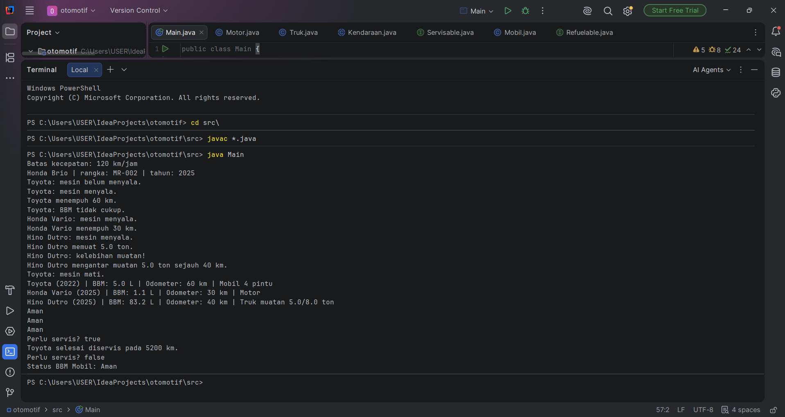

# Responsi Praktikum PBO: Otomotif

## Identitas
- **Nama**: Anjani
- **NIM**: H1D025119
- **Tema**: Otomotif
- Jurusan Informatika, Fakultas Teknik, Universitas Jenderal Soedirman

Studi kasus otomotif yang berkaitan dengan kendaraan. Ada mobil, motor, dan truk yang bisa dinyalakan, diisi bensin, dan dijalankan. Khusus mobil dan truk, bisa diservis. Mobil, motor, dan truk merupakan turunan dari satu class induk yang namanya Kendaraan.

## Struktur Class
| File | Keterangan |
|---|---|
| `Kendaraan.java` | Superclass abstract |
| `Mobil.java` | Subclass, implements `Servisable` dan `Refuelable` |
| `Motor.java` | Subclass, implements `Refuelable` |
| `Truk.java` | Subclass, implements `Servisable` dan `Refuelable` |
| `Servisable.java` | Interface servis berkala |
| `Refuelable.java` | Interface status bahan bakar |
| `Main.java` | Alur pengujian seluruh persyaratan |

## Cara Compile dan Run
```bash
cd src
javac *.java
java Main
```

## Screenshot Luaran


